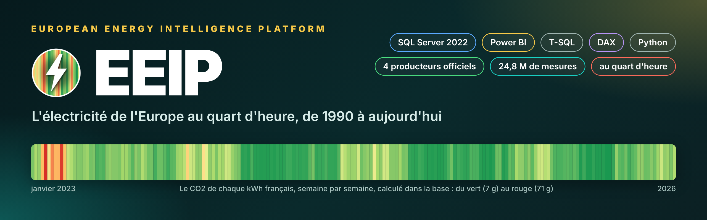
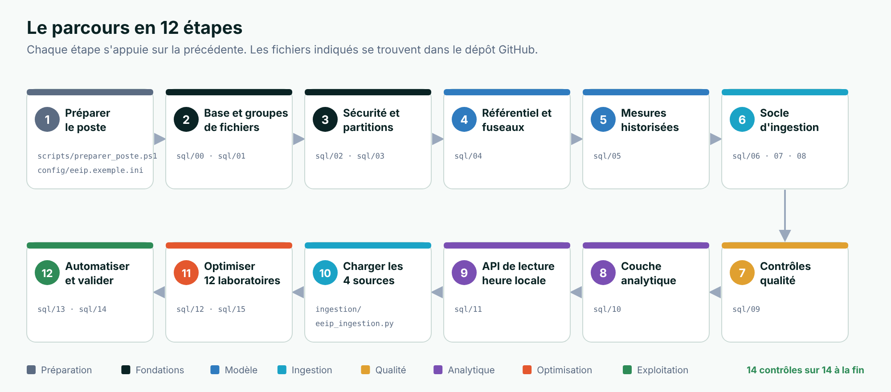
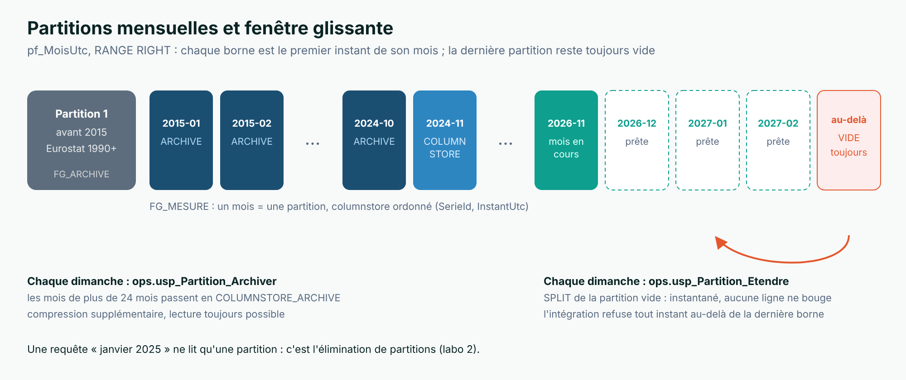
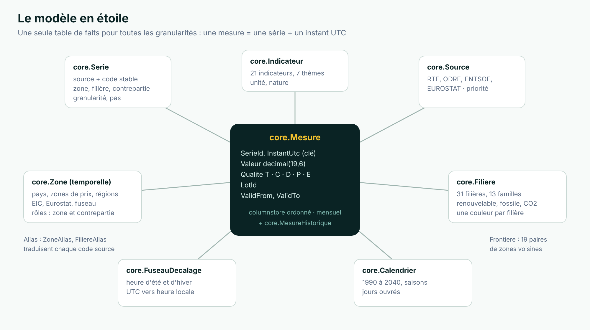
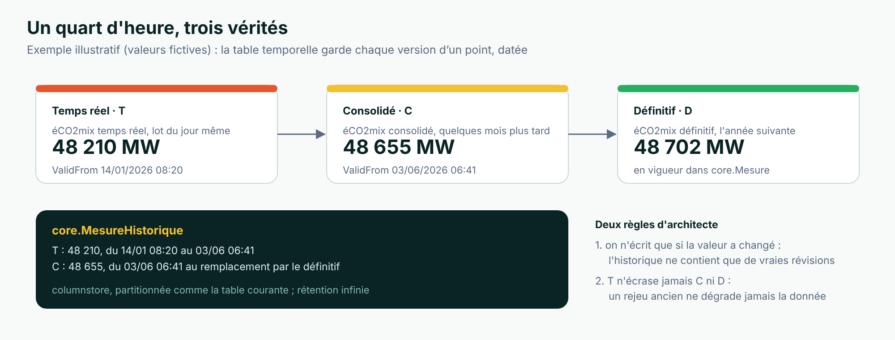
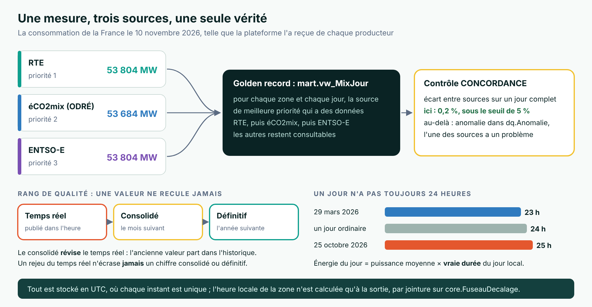
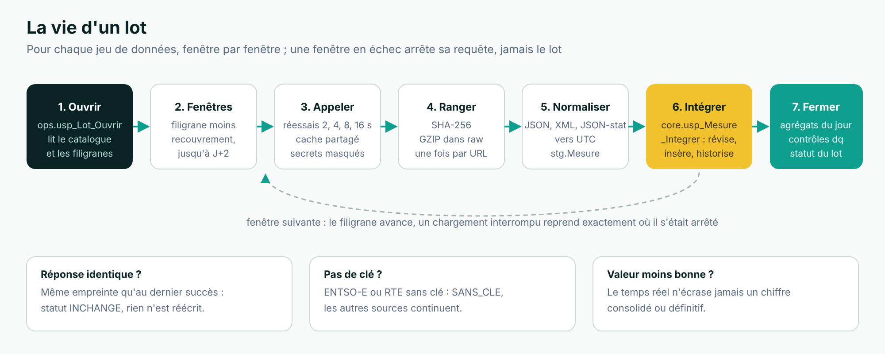
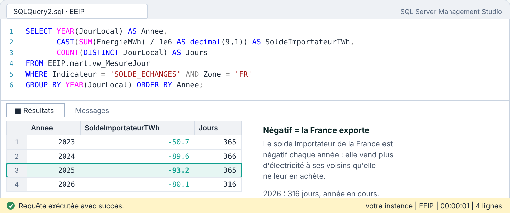
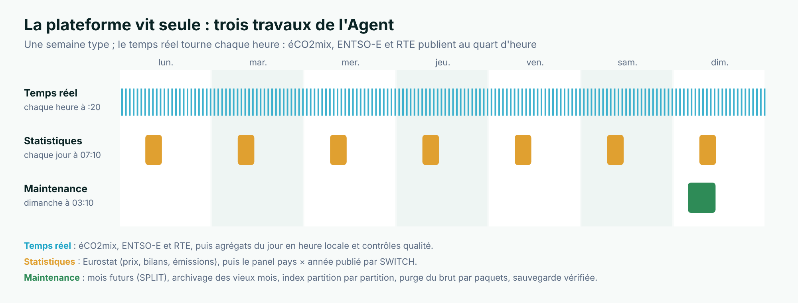
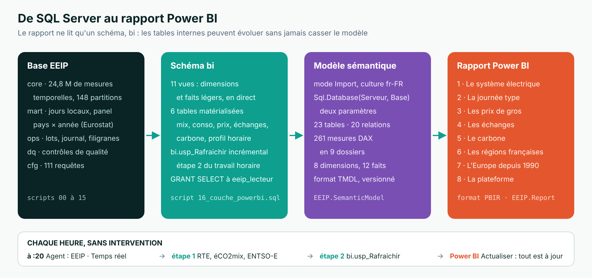

<p align="center"></p>

# 📘 Le guide de construction d'EEIP

**Construire, étape par étape, l'entrepôt européen de l'électricité sur SQL Server 2022, puis son rapport Power BI.**
Chaque étape suit le même ordre : **pourquoi**, **faites**, puis **vérifiez**. Ne passez à la suite que si le résultat attendu est là.

> Le même guide existe en PDF de 15 pages, à garder sur un second écran : **[docs/EEIP_Guide_Public.pdf](docs/EEIP_Guide_Public.pdf)**. Cette page reprend tout son contenu, avec chaque commande dans un bloc à copier, et ajoute l'étape 13 : la couche Power BI.



## Sommaire

| | Étape | Fichiers | Durée |
|---|---|---|---|
| 0 | [Avant de commencer](#0--avant-de-commencer) | | 5 min |
| 1 | [Préparer le poste et obtenir les deux clés](#1--préparer-le-poste-et-obtenir-les-deux-clés) | `scripts/preparer_poste.ps1` · `config/eeip.exemple.ini` | 15 min |
| 2 | [La base et ses groupes de fichiers](#2--la-base-et-ses-groupes-de-fichiers) | `sql/00` · `sql/01` | 2 min |
| 3 | [Sécurité et partitionnement mensuel](#3--sécurité-et-partitionnement-mensuel) | `sql/02` · `sql/03` | 1 min |
| 4 | [Le référentiel et les fuseaux horaires](#4--le-référentiel-et-les-fuseaux-horaires) | `sql/04` | 1 min |
| 5 | [La table des mesures, partitionnée et historisée](#5--la-table-des-mesures-partitionnée-et-historisée) | `sql/05` | 1 min |
| 6 | [Le socle d'ingestion](#6--le-socle-dingestion) | `sql/06` · `sql/07` · `sql/08` | 1 min |
| 7 | [Les contrôles qualité](#7--les-contrôles-qualité) | `sql/09` | 1 min |
| 8 | [La couche analytique de l'énergéticien](#8--la-couche-analytique-de-lénergéticien) | `sql/10` | 1 min |
| 9 | [L'API de lecture et le voyage dans le temps](#9--lapi-de-lecture-et-le-voyage-dans-le-temps) | `sql/11` | 1 min |
| 10 | [Charger les quatre sources](#10--charger-les-quatre-sources) | `ingestion/eeip_ingestion.py` | 1 h 30 à 2 h |
| 11 | [Le laboratoire d'optimisation](#11--le-laboratoire-doptimisation) | `sql/12` · `sql/15` | à votre rythme |
| 12 | [Automatiser et valider](#12--automatiser-et-valider) | `sql/13` · `sql/14` | 10 min |
| 13 | [La couche Power BI et le rapport](#13--la-couche-power-bi-et-le-rapport) | `sql/16` · `powerbi/EEIP.pbip` | 10 min |
| | [Pièges connus et solutions](#pièges-connus-et-solutions) | | |

---

## 0 · Avant de commencer

### Les outils, tous gratuits

| Outil | Rôle |
|---|---|
| **SQL Server 2022 Developer** | le moteur, avec toutes les fonctions de l'édition Enterprise |
| **SSMS** | exécuter le SQL, lire les plans d'exécution |
| **Python 3.12 ou plus** | lire les sources ; installé **pour tous les utilisateurs** |
| **ODBC Driver 18 for SQL Server** | relier Python à SQL Server |
| **Power BI Desktop** | ouvrir le rapport (étape 13) |
| **Jeton ENTSO-E** | gratuit, sur demande : quelques jours |
| **Application RTE** | gratuite, immédiate |
| **10 Go libres** | pour la base et sa sauvegarde |

### Trois réflexes dans SSMS

1. Une nouvelle requête s'ouvre sur `master` : vérifiez que la liste des bases affiche **EEIP**, ou commencez par `USE EEIP;`.
2. Ouvrir un script : **Fichier**, **Ouvrir**, **Fichier** (Ctrl+O), puis **F5**. Tous les scripts sont **rejouables** : les relancer ne casse rien et ne crée aucun doublon.
3. Le plan d'exécution réel (**Ctrl+M**) s'active fenêtre par fenêtre.

> 🔵 **Le regard de l'architecte.** Placez le dépôt dans `C:\EEIP` : les travaux planifiés de l'étape 12 s'attendent à ce chemin.

---

## 1 · Préparer le poste et obtenir les deux clés

**Fichiers** : `scripts/preparer_poste.ps1` · `config/eeip.exemple.ini` · `ingestion/requirements.txt`

**Pourquoi.** La plateforme tournera chaque heure **sans vous**, lancée par l'Agent SQL Server sous son propre compte Windows. Ce compte doit pouvoir exécuter Python et écrire les journaux dans `C:\EEIP` : c'est pour lui que Python s'installe pour tous les utilisateurs.

**Faites.**

1. **Python** : sur python.org, menu **Downloads**, le **Windows installer (64-bit)**. Choisissez **Customize installation** et cochez **Install Python for all users**.
2. **Le dépôt** : sur GitHub, **Code**, **Download ZIP**, puis extrayez le contenu dans `C:\EEIP`. Avec Git :
   ```powershell
   git clone https://github.com/abdoulhamiddiallo/eeip-sql-server C:\EEIP
   ```
3. **Préparation automatique**, dans un **Terminal (administrateur)**. Pour une instance nommée, remplacez `MSSQLSERVER` par ce qui suit la barre oblique inverse dans SSMS :
   ```powershell
   powershell -ExecutionPolicy Bypass -File C:\EEIP\scripts\preparer_poste.ps1 -Instance MSSQLSERVER
   ```
   Le script crée l'environnement Python `C:\EEIP\.venv`, installe les bibliothèques, vérifie ODBC 18, met l'Agent en démarrage automatique et lui donne les droits sur `C:\EEIP`.
4. **Configuration** : copiez `config\eeip.exemple.ini` en `config\eeip.ini` avec le Bloc-notes (encodage **UTF-8**), renseignez `serveur`, puis les clés ci-dessous dès que vous les avez.

**Clé 1 · ENTSO-E (à demander tout de suite)**

1. Créez un compte sur `transparency.entsoe.eu` (**Login**, **Register**).
2. Écrivez à `transparency@entsoe.eu`, objet :
   ```text
   Restful API access
   ```
   avec l'adresse de votre compte dans le message.
3. Une fois l'accès ouvert : **My Account Settings**, **Generate a new token**. Collez-le dans `jeton`.

**Clé 2 · RTE (immédiate)**

1. Créez un compte sur `data.rte-france.com`.
2. Abonnez-vous à **Consumption**, **Actual Generation** et **Physical Flow**, toutes trois avec une même application nommée :
   ```text
   EEIP
   ```
3. **Mes applications**, **EEIP** : copiez l'**ID client** et l'**ID secret** dans `id_client` et `secret_client`.

> 🔵 **Sans attendre les clés.** ODRÉ (éCO2mix) et Eurostat sont ouverts. Sans clé, le programme marque les requêtes RTE et ENTSO-E `SANS_CLE` et charge tout le reste ; il les prendra au passage suivant l'ajout des clés. Le jeton n'apparaît jamais dans les journaux ni dans la base : il y est remplacé par `***`.

✅ **Vérifiez.** Le script se termine par **Poste prêt**, chaque ligne affiche **OK** et l'Agent est **Running**. Si la ligne ODBC affiche **À FAIRE**, installez **ODBC Driver 18 for SQL Server** depuis Microsoft Learn, puis relancez le script.

---

## 2 · La base et ses groupes de fichiers

**Fichiers** : `sql/00_verification_instance.sql` · `sql/01_base.sql`

**Pourquoi.** Des données qui vivent différemment ne partagent pas le même fichier : les statistiques d'avant 2015 ne bougent plus, le quart d'heure récent arrive toutes les heures, le brut grossit vite. `PRIMARY` ne garde que le catalogue système : une base dont le groupe principal reste petit redémarre et se restaure plus vite.

| Groupe | Contenu |
|---|---|
| `FG_MESURE` | les mesures depuis 2015, un mois par partition |
| `FG_ARCHIVE` | tout ce qui précède 2015 (Eurostat depuis 1990) |
| `FG_REFERENTIEL` | référentiel et configuration, **groupe par défaut** |
| `FG_MART` | la couche analytique |
| `FG_BRUT` | réponses brutes et transit, très écrits |
| `PRIMARY` | catalogue système seul |

**Faites.** Connectez SSMS à votre instance. Exécutez `00_verification_instance.sql` : il ne modifie rien, il contrôle la version, les fuseaux horaires, l'Agent, vos droits et l'espace disque. Puis exécutez `01_base.sql`.

> 🔵 **Le regard de l'architecte.**
> `READ_COMMITTED_SNAPSHOT` : les lecteurs ne bloquent jamais le chargement.
> `ACCELERATED_DATABASE_RECOVERY` : annuler un gros lot est instantané.
> `QUERY_STORE` : la boîte noire des performances.
> `PARAMETER_SENSITIVE_PLAN_OPTIMIZATION` (SQL Server 2022) : un plan pour la France et ses dizaines de séries, un autre pour une région qui n'en a que deux.
> `DOP_FEEDBACK` : le parallélisme s'ajuste seul.

✅ **Vérifiez.** Script 00 : **OK : SQL Server 2022 ou plus récent**, 8 fuseaux listés, l'Agent en **Running**, `JeSuisSysadmin = 1`, **Libre : on peut créer EEIP**. Script 01 : **Base EEIP créée.** et **7 fichiers**, six de données et le journal.

---

## 3 · Sécurité et partitionnement mensuel

**Fichiers** : `sql/02_schemas_securite.sql` · `sql/03_partitionnement.sql`

**Faites.** Exécutez les deux scripts.

- **Huit schémas**, un par couche : `cfg`, `raw`, `stg`, `core`, `dq`, `mart`, `api`, `ops`.
- **Deux rôles** : `eeip_chargeur`, qui reçoit le compte de l'Agent et ne fait qu'exécuter des procédures et écrire dans le transit ; `eeip_lecteur`, qui ne voit que `mart`, `api` et, à l'étape 13, `bi`.



**Pourquoi par mois.** Au quart d'heure, une seule série produit 35 000 points par an : on découpe donc **par mois**. Les bornes sont générées par `GENERATE_SERIES`, de janvier 2015 à trois mois après le mois en cours. **La dernière partition reste toujours vide** : avec un columnstore, SQL Server ne coupe (`SPLIT`) qu'une partition vide, et la maintenance crée ainsi chaque mois le suivant **sans déplacer une ligne**.

✅ **Vérifiez.** Script 02 : 8 schémas, le compte de l'Agent membre de `eeip_chargeur`. Script 03 : `pf_MoisUtc` et `pf_MoisDate` avec environ 147 partitions ; un instant de 1990 et `2014-12-31 23:45` en **partition 1**, `2015-01-01 00:00` en **partition 2**.

---

## 4 · Le référentiel et les fuseaux horaires

**Fichier** : `sql/04_referentiel.sql`

> 🔵 **Trois décisions d'architecte.**
> 1. `core.Zone` est **temporelle** : si un code EIC ou un fuseau change, l'ancienne version reste lisible.
> 2. `cfg.RequeteACharger.Parametres` est une colonne JSON validée par `ISJSON(Parametres, OBJECT)` (SQL Server 2022) : une faute de frappe est refusée dès l'insertion.
> 3. `core.FuseauDecalage` pré-calcule les heures d'été et d'hiver de chaque fuseau : une jointure par intervalle remplace des millions d'`AT TIME ZONE`.

**Pourquoi des alias.** `B14` chez ENTSO-E, `N9000` chez Eurostat, `NUCLEAR` chez RTE, `nucleaire` chez éCO2mix : quatre codes, une seule filière **NUCLEAIRE**. Les alias traduisent chaque code source dans le vocabulaire de la plateforme.



✅ **Vérifiez.** 13 tables, dont `core.Zone` en `SYSTEM_VERSIONED_TEMPORAL_TABLE` ; un calendrier de **18 628 jours**, du 1er janvier 1990 au 31 décembre 2040.

---

## 5 · La table des mesures, partitionnée et historisée

**Fichier** : `sql/05_mesure_temporelle.sql`

**Pourquoi.** Le cœur de la plateforme : **une ligne par série et par instant**, du quart d'heure éCO2mix à la statistique annuelle Eurostat. Une seule procédure d'intégration, un seul modèle. Son architecture est le choix le plus important du guide.

| Élément | Rôle |
|---|---|
| Columnstore cluster **ORDONNÉ** `(SerieId, InstantUtc)` | stockage en colonnes, compression d'environ 10 fois, mode batch ; les segments triés par série sont sautés quand ils ne contiennent pas la série demandée (SQL Server 2022) |
| Clé primaire **NON cluster**, alignée | l'unicité (série, instant) est garantie, et une révision retrouve sa ligne en quelques lectures, même parmi des dizaines de millions |
| **Versionnement système** | chaque ancienne version part dans `core.MesureHistorique`, columnstore et partitionnée, rétention infinie |
| **Rang de qualité** | temps réel, consolidé, définitif : une valeur ne peut être remplacée que par une valeur au moins aussi bonne |



> 🟠 **L'ordre compte.** L'historique d'abord, puis la table courante qui le désigne, puis le columnstore qui la transforme. Le script le fait pour vous. Si votre version refuse `ORDER (SerieId, InstantUtc)`, retirez cette ligne des scripts 05 et 10 : tout fonctionne, avec une élimination de segments moins forte.

✅ **Vérifiez.** `core.Mesure` en `SYSTEM_VERSIONED_TEMPORAL_TABLE` ; trois index, `CCI_Mesure`, `PK_Mesure` et `CCI_MesureHistorique`, tous sur `ps_MoisUtc` ; colonnes de tri `SerieId` rang 1 et `InstantUtc` rang 2.

---

## 6 · Le socle d'ingestion

**Fichiers** : `sql/06_exploitation_brut_transit.sql` · `sql/07_donnees_reference.sql` · `sql/08_procedures_ingestion.sql`

**Faites.** Exécutez les trois scripts.

- **06** crée les lots, le journal, le brut compressé et le transit.
- **07** remplit le vocabulaire et génère le catalogue : 11 zones croisées avec les documents ENTSO-E, 11 marchés, et les flux de chaque frontière **dans les deux sens**. Ajouter une frontière ajoute donc ses deux requêtes.
- **08** crée les 8 procédures d'intégration.

| Code | Contenu | Source | Requêtes | Format |
|---|---|---|---:|---|
| `A65` | consommation réalisée | ENTSO-E | 80 au total | XML, jeton |
| `A75` | production réalisée par filière | ENTSO-E | | |
| `A44` | prix du marché à un jour | ENTSO-E | | |
| `A11` | flux physiques transfrontaliers | ENTSO-E | | |
| `A68` | capacité installée par filière | ENTSO-E | | |
| éCO2mix | national, consolidé, définitif, régions, gaz | ODRÉ | 17 | JSON, sans clé |
| | consommation, production par filière, flux physiques | RTE | 3 | JSON, OAuth 2 |
| | prix des ménages, bilans, mix primaire, émissions | Eurostat | 11 | JSON-stat |

**Les règles de `core.usp_Mesure_Integrer`**

1. Chaque code distinct est résolu **une seule fois**, jamais ligne à ligne.
2. Rien ne se perd : zone inconnue déduite, filière inconnue dans `AUTRES`, une anomalie à chaque fois.
3. Un instant au-delà de la dernière borne est refusé : la dernière partition reste vide.
4. Révision **seulement si la valeur change** et si la qualité est au moins aussi bonne.
5. Le filigrane avance : le passage suivant reprendra là.

✅ **Vérifiez.** Script 06 : 7 tables, `raw.Payload` et `stg.Mesure` sur `FG_BRUT`. Script 07 : **4 sources, 21 indicateurs, 51 zones, 31 filières, 65 alias de filières, 19 frontières, 111 requêtes**. Le calcul des fuseaux prend 10 à 30 secondes. Script 08 : **8 procédures**, de `cfg.usp_Cfg_Marquer` à `stg.usp_Transit_Purger`.

---

## 7 · Les contrôles qualité

**Fichier** : `sql/09_qualite.sql`

Lancés à la fin de chaque lot. Les seuils vivent dans `dq.Regle` : on les ajuste **sans toucher au code**.

| Contrôle | Ce qu'il détecte |
|---|---|
| `FRAICHEUR` | une requête qui n'apporte plus de données récentes |
| `HORS_BORNES` | un prix aberrant, une puissance démesurée, une production négative |
| `SAUT` | une consommation qui varie brutalement d'un point à l'autre |
| `TROU` | des quarts d'heure manquants, trouvés par `LAG` |
| `REVISION_FORTE` | une valeur révisée de plus de 20 %, lue dans l'historique |
| `CONCORDANCE` | RTE, éCO2mix et ENTSO-E en désaccord sur un jour |
| `ZONE_DEDUITE` | une zone sans correspondance, à rattacher |
| `CODE_INCONNU` | une filière de la source sans alias |

✅ **Vérifiez.** **Commandes exécutées avec succès.** La procédure cite `mart.MesureJour`, créée à l'étape suivante : SQL Server l'accepte, car une procédure résout ses tables à l'exécution.

---

## 8 · La couche analytique de l'énergéticien

**Fichier** : `sql/10_mart_analytique.sql`

- `mart.MesureJour` : chaque série en **jour local** : moyenne, pointe, creux, énergie en MWh, minutes de prix négatifs, complétude ; recalculée pour les seuls jours touchés.
- **5 vues** prêtes : jour, mix, prix, échanges, intensité carbone.
- `mart.PanelPaysAnnee` : 20 indicateurs par pays et par an, reconstruit à part puis basculé par `SWITCH`.



> 🔵 **Le golden record.** Pour un même jour et une même zone, plusieurs producteurs publient la même grandeur. La couche analytique retient **RTE, puis éCO2mix, puis ENTSO-E** : la source la plus fiable l'emporte, jour par jour, et l'écart entre sources alimente le contrôle `CONCORDANCE`.

✅ **Vérifiez.** 3 tables (`MesureJour`, `PanelPaysAnnee` et sa jumelle de chargement), 5 vues, 2 procédures : `usp_MesureJour_Rafraichir` et `usp_Panel_Rafraichir`. Elles se rempliront à l'étape 10.

---

## 9 · L'API de lecture et le voyage dans le temps

**Fichier** : `sql/11_api_lecture.sql`

Les consommateurs ne lisent jamais `core` : ils appellent cinq procédures, qui rendent un tableau ou du **JSON**, toujours **en heure locale de la zone**.

| Procédure | Ce qu'elle rend |
|---|---|
| `api.usp_Serie_Obtenir` | un indicateur d'une zone, au quart d'heure, à l'heure, au jour ou au mois (`DATE_BUCKET`), de la meilleure source ou d'une source imposée, telle qu'elle est ou **telle qu'elle était à une date** (`@VuAuUtc`) |
| `api.usp_Mix_Obtenir` | le mix d'une zone par jour, mois ou année : énergie en GWh et part de chaque famille de filières |
| `api.usp_Prix_Comparer` | les prix de plusieurs zones face à la première, avec les heures de prix négatifs (`STRING_SPLIT` avec ordinal, clause `WINDOW`) |
| `api.usp_Revisions_Lister` | toutes les versions d'une mesure à un instant : valeur, qualité, connue depuis, remplacée le |
| `api.usp_Catalogue` | le catalogue en JSON : chaque indicateur, ses zones, ses sources et ses pas de temps |

**Le voyage dans le temps.** `FOR SYSTEM_TIME AS OF` lit la table temporelle telle qu'elle était à un instant. La plateforme répond donc à la question d'un auditeur : quelle consommation affichions-nous il y a une semaine ? Le temps réel de l'époque, avant que le consolidé ne le révise.

```sql
DECLARE @vu datetime2(3) = DATEADD(DAY, -7, SYSUTCDATETIME());
EXEC api.usp_Serie_Obtenir @Indicateur = 'CONSO_ELEC',
     @Zone = 'FR', @Pas = 'P1D', @VuAuUtc = @vu;
```

Le voyage remonte jusqu'à votre premier chargement : la base ne peut pas savoir ce qu'elle n'a pas encore reçu.

> 🔵 **Toujours l'heure locale.** Les heures demandées (`@Debut`, `@Fin`) sont locales : la procédure les convertit une seule fois en UTC, puis lit les partitions utiles. La conversion inverse, à la sortie, se fait par jointure sur `core.FuseauDecalage`.

✅ **Vérifiez.** 5 procédures dans le schéma `api`.

---

## 10 · Charger les quatre sources

**Fichiers** : `ingestion/eeip_ingestion.py` · `config/eeip.ini`



Un seul programme, quatre couches : **fenêtres** (du filigrane moins le recouvrement jusqu'à après-demain, pour les prix du lendemain), **extraction** (une méthode par producteur, réessais), **analyse** (chaque format en lignes uniformes, en UTC), **orchestration** (les requêtes d'un même jeu partagent un appel par fenêtre).

Dans un Terminal, placez-vous dans le dépôt :

```powershell
cd C:\EEIP
```

**1. Les diagnostics**, sans rien écrire (attendu : `HTTP 200`, champs disponibles, premières mesures reconnues) :

```powershell
.\.venv\Scripts\python.exe ingestion\eeip_ingestion.py --tester ODRE --jeu eco2mix-national-tr
.\.venv\Scripts\python.exe ingestion\eeip_ingestion.py --tester EUROSTAT --jeu nrg_cb_pem
.\.venv\Scripts\python.exe ingestion\eeip_ingestion.py --tester ENTSOE --zone FR --jeu A44
.\.venv\Scripts\python.exe ingestion\eeip_ingestion.py --tester RTE --jeu consumption
```

**2. Eurostat** (2 à 5 minutes, attendu : `SUCCES : 11`) :

```powershell
.\.venv\Scripts\python.exe ingestion\eeip_ingestion.py --sources EUROSTAT
```

puis dans SSMS (attendu : un panel de 1 000 à 1 500 lignes pays × année) :

```sql
EXEC EEIP.mart.usp_Panel_Rafraichir;
```

**3. éCO2mix**, le temps réel depuis janvier 2025, puis le consolidé et le définitif (10 à 30 minutes ; la colonne des révisées se remplit : le consolidé remplace le temps réel), puis les régions et le gaz :

```powershell
.\.venv\Scripts\python.exe ingestion\eeip_ingestion.py --sources ODRE --jeu national-tr
.\.venv\Scripts\python.exe ingestion\eeip_ingestion.py --sources ODRE --jeu cons-def
.\.venv\Scripts\python.exe ingestion\eeip_ingestion.py --sources ODRE
```

**4. ENTSO-E** (80 requêtes, environ 1 000 appels, 40 à 90 minutes ; quelques `VIDE` sont normaux). Pour avancer par étapes, ajoutez `--limite-fenetres 2` :

```powershell
.\.venv\Scripts\python.exe ingestion\eeip_ingestion.py --sources ENTSOE
```

**5. RTE** (3 requêtes en `SUCCES`, par fenêtres de 7 jours depuis janvier 2025) :

```powershell
.\.venv\Scripts\python.exe ingestion\eeip_ingestion.py --sources RTE
```

**6. L'idempotence** : relancez Eurostat, la réponse arrive en quelques secondes avec `INCHANGE : 11`.

```powershell
.\.venv\Scripts\python.exe ingestion\eeip_ingestion.py --sources EUROSTAT
```

> 🔵 **Quatre détails de gourou.**
> - **éCO2mix** : le temps réel et le consolidé portent le même code de série ; le consolidé révise donc le temps réel, et l'historique le prouve.
> - **ENTSO-E** : une courbe de type `A03` n'envoie un point que lorsque la valeur change ; le programme prolonge la valeur précédente.
> - **RTE** : jeton OAuth 2 renouvelé seul ; dates en journées entières à l'heure de Paris.
> - **Eurostat** : un jeu partagé par plusieurs requêtes n'est appelé qu'une fois (cache).

> 🟠 **Interruption.** Fermeture de fenêtre ou coupure réseau : relancez la même commande. Le filigrane reprend à la dernière fenêtre réussie, et une réponse identique à la précédente n'est pas réintégrée. Un lot resté `EN_COURS` est fermé par le lot suivant après 3 heures de silence ; ses données sont gardées.

### Vérifier le chargement dans SSMS

**Les lots** : chaque exécution laisse sa trace (attendu : des lots en `SUCCES` ou `PARTIEL` ; une requête `VIDE` ou refusée n'arrête pas le lot).

```sql
USE EEIP;
SELECT TOP (10) LotId, Sources, Statut, NbAppels, NbInserees, NbRevisees
FROM ops.Lot ORDER BY LotId DESC;
```

**Le mix de la France**, famille par famille, de la meilleure source (attendu : `NUCLEAIRE` en tête avec près de 70 % de la production) :

```sql
EXEC api.usp_Mix_Obtenir @Zone = 'FR', @Debut = '2026-01-01', @Fin = '2027-01-01', @Pas = 'P1Y';
```

**La France, exportatrice d'électricité** : le solde importateur annuel, négatif quand la France vend plus qu'elle n'achète.

```sql
SELECT YEAR(JourLocal) AS Annee,
       CAST(SUM(EnergieMWh) / 1e6 AS decimal(9,1)) AS SoldeImportateurTWh,
       COUNT(DISTINCT JourLocal) AS Jours
FROM EEIP.mart.vw_MesureJour
WHERE Indicateur = 'SOLDE_ECHANGES' AND Zone = 'FR'
GROUP BY YEAR(JourLocal) ORDER BY Annee;
```



✅ **Vérifiez.** Les années sont négatives : environ 50 TWh d'exportations nettes en 2023, près de 90 TWh en 2024 et en 2025. Le calcul se fait en jours locaux : les jours de 23 et 25 heures comptent juste.

---

## 11 · Le laboratoire d'optimisation

**Fichiers** : `sql/12_laboratoire_optimisation.sql` · `sql/15_requetes_analyse.sql`

Douze expériences, à lancer bloc par bloc : sélectionnez un bloc, **F5**. Activez d'abord le plan réel avec **Ctrl+M**.

| N° | Ce que vous observez | Où regarder |
|---:|---|---|
| 1 | les lignes et la compression de chaque partition mensuelle | Résultats |
| 2 | `CAST(InstantUtc AS date)` lit toutes les partitions, un intervalle n'en lit qu'une | plan : Actual Partition Count |
| 3 | `AT TIME ZONE` sur la colonne contre des bornes converties une fois | Messages : CPU time |
| 4 | le columnstore ordonné saute les segments des autres séries | Messages : segment skipped |
| 5 | mode batch contre mode ligne sur le même agrégat | plan : Actual Execution Mode |
| 6 | groupes de lignes ouverts (delta) et compressés, puis compression immédiate | Résultats |
| 7 | la recherche d'un quart d'heure passe par la clé non cluster | Messages : lectures logiques |
| 8 | `PERCENTILE_CONT` exact contre `APPROX_PERCENTILE_CONT` | Messages : elapsed time |
| 9 | un plan par profil de paramètre : la France contre la Bretagne | `sys.query_store_query_variant` |
| 10 | les requêtes les plus coûteuses, et une indication posée sans toucher au code | Query Store |
| 11 | le gain estimé de `COLUMNSTORE_ARCHIVE` sur un vieux mois | Résultats |
| 12 | toutes les versions d'un quart d'heure, puis la consommation vue il y a 30 jours | Résultats |

> 🔵 **Règles d'or.**
> - Jamais de fonction sur une colonne filtrée : on transforme la constante, pas la colonne.
> - Le columnstore aime les gros lots ; les petits chargements horaires passent par un magasin delta, compressé chaque dimanche.
> - Le Query Store garde la mémoire des performances : une indication s'y pose sans redéployer.

**Allez plus loin avec le script 15.** Douze questions d'énergéticien, une requête chacune : la courbe en canard du solaire, le jour de pointe de chaque année, les heures de prix négatifs, l'écart de prix France-Allemagne et sa corrélation avec l'éolien allemand (Pearson en pur SQL), le classement carbone des zones, le solde par voisin, le facteur de charge du nucléaire, et trois sources pour une même consommation.

---

## 12 · Automatiser et valider

**Fichiers** : `sql/13_exploitation_agent.sql` · `sql/14_controle_final.sql`

Une plateforme de production se met à jour, s'entretient et se sauvegarde seule. Le script 13 crée cinq procédures de maintenance et trois travaux de l'Agent SQL Server.



**Faites.**

1. Exécutez `13_exploitation_agent.sql` : un tableau liste **EEIP · Maintenance**, **EEIP · Statistiques** et **EEIP · Temps réel**.
2. Dans l'Explorateur d'objets : **SQL Server Agent**, **Travaux**. Clic droit sur chaque travail EEIP, **Démarrer le travail à l'étape...**, **Démarrer**, un à la fois.
3. Exécutez `14_controle_final.sql` : la base se contrôle elle-même.

> 🔵 **Deux choix d'exploitation.** La purge du brut se fait **par paquets de 2 000** : un seul `DELETE` ferait grossir le journal et verrouillerait la table. Et la Maintenance se lance **après** le temps réel : elle reconstruit les index de la table que le temps réel remplit.

> 🟠 **« Démarrer a échoué ».** Le travail tourne déjà, souvent lancé par un premier clic ou par sa planification : un travail ne tourne jamais deux fois en même temps. Fermez la fenêtre et attendez sa fin.

✅ **Vérifiez : le résultat final.** Les trois travaux affichent **Succès**. En cas d'échec, **Afficher l'historique** donne le message ; la sortie de Python est aussi dans `C:\EEIP\logs`. Puis le script 14 rend **14 lignes OK sur 14** :

- fichiers, options, schémas, rôles ;
- partitions prêtes deux mois à l'avance, la dernière vide ;
- table temporelle, columnstore ordonné, clé alignée ;
- référentiel, fuseaux ;
- éCO2mix, ENTSO-E et Eurostat chargés ;
- historisation, brut compressé et relisible ;
- agrégats et mix de la France, API, travaux de l'Agent.

---

## 13 · La couche Power BI et le rapport

**Fichiers** : `sql/16_couche_powerbi.sql` · `powerbi/EEIP.pbip`



**Pourquoi.** Le rapport ne lit **qu'un schéma**, `bi`, aux noms en français. Les tables internes peuvent évoluer sans jamais casser le modèle. Les dimensions et les faits légers sont des **vues** lues en direct ; les faits lourds sont **matérialisés** par `bi.usp_Rafraichir`, qui ne reprend que les jours recalculés depuis son passage précédent (filigrane `BI_DERNIER_CALCUL`) : une révision consolidée d'éCO2mix sur un jour ancien est donc bien propagée.

**Faites.**

1. Exécutez `16_couche_powerbi.sql` (le premier remplissage prend quelques minutes). Le script crée **11 vues**, **6 tables**, la procédure, donne la lecture à `eeip_lecteur` et ajoute l'**étape 2 · Couche Power BI** au travail **EEIP · Temps réel**.
2. Ouvrez `C:\EEIP\powerbi\EEIP.pbip` dans Power BI Desktop.
3. Si votre instance ne s'appelle pas `localhost\MSSQLSERVER2022` : **Accueil**, **Transformer les données**, **Modifier les paramètres**, puis renseignez `Serveur` avec le nom affiché par SSMS.
4. **Actualiser**. À la question d'identification, choisissez **Windows**, **Utiliser mes informations d'identification actuelles**, **Se connecter**.
5. **Ctrl+S** pour enregistrer.

✅ **Vérifiez.** Les huit pages s'affichent, le bandeau indique **Données à jour** avec la date du dernier lot, et la page **Le système électrique** montre la France de l'année choisie. Chaque heure, l'Agent recharge les sources puis la couche `bi` : une actualisation suffit à Power BI.

Le détail du modèle (23 tables, 20 relations, 261 mesures DAX et leur code) est dans **[docs/MODELE_SEMANTIQUE.md](docs/MODELE_SEMANTIQUE.md)**.

---

## Pièges connus et solutions

| Symptôme | Cause | Solution |
|---|---|---|
| `Procédure stockée ... introuvable` | la requête s'exécute dans `master` | choisissez **EEIP** dans la liste des bases, ou `USE EEIP;` |
| `Data source name not found` | pilote ODBC 18 absent | installez **ODBC Driver 18 for SQL Server**, relancez `preparer_poste.ps1` |
| `Login failed for user` sous l'Agent | compte de l'Agent absent de la base | relancez le script 02 : il crée l'utilisateur et l'ajoute à `eeip_chargeur` |
| Script 05 : erreur sur `ORDER (...)` | columnstore ordonné non accepté | retirez la ligne `ORDER` des scripts 05 et 10 |
| ODRÉ : `Unknown field` ou `aucun des champs` | Opendatasoft a renommé un champ | `--tester ODRE --jeu <jeu>` liste les champs ; corrigez `champs` dans `Parametres` avec `JSON_MODIFY` |
| ENTSO-E : jeton refusé (HTTP 401) | jeton mal copié ou pas encore activé | recollez-le dans `eeip.ini`, sans espace ; sinon attendez la réponse d'ENTSO-E |
| ENTSO-E : requête `VIDE` | la zone ne publie pas ce document | normal pour quelques couples zone et document ; `Actif = 0` pour la désactiver |
| ENTSO-E : HTTP 429 | trop d'appels par minute | les réessais attendent seuls ; sinon `pause_entre_appels = 1.0` |
| RTE : jeton refusé (HTTP 401) | mauvais identifiant ou secret | recopiez l'**ID client** et l'**ID secret** depuis **Mes applications** |
| RTE : HTTP 403 sur une API | application non abonnée à cette API, ou refus ponctuel | vérifiez l'abonnement (étape 1) ; un refus ponctuel est rattrapé seul au passage suivant, sans perte |
| Eurostat : HTTP 400 ou réponse sans valeurs | code de filtre absent, requête trop large | `--tester EUROSTAT --jeu <jeu>` liste les codes réels ; corrigez `Parametres` |
| Anomalie `CODE_INCONNU` ou `ZONE_DEDUITE` | un code de la source sans alias | ajoutez l'alias dans `core.FiliereAlias` ou `core.ZoneAlias`, puis relancez avec `--forcer` |
| Solde des échanges positif | convention de signe inverse de la source | `FacteurEchelle = -1` sur les requêtes ODRÉ d'échanges, filigrane remis à `NULL`, puis relance |
| Points au-delà de la dernière partition | maintenance arrêtée longtemps | `EXEC ops.usp_Partition_Etendre;` puis relancez |
| Power BI : « Impossible de se connecter » | paramètre `Serveur` différent de votre instance | **Transformer les données**, **Modifier les paramètres** (étape 13) |
| Power BI : une table du schéma `bi` introuvable | script 16 pas encore exécuté | exécutez `16_couche_powerbi.sql`, puis **Actualiser** |

### Étendre la plateforme : une ligne suffit

Une zone de prix de plus, par exemple la Norvège Sud :

```sql
INSERT EEIP.cfg.RequeteACharger (SourceCode, Jeu, Parametres, IndicateurCode, ZoneCode, DebutHistorique, FenetreJours, RecouvrementJours)
VALUES ('ENTSOE', 'A44', N'{"documentType":"A44","domaine":"in_out","contract_MarketAgreement.type":"A01"}', 'PRIX_SPOT_J1', 'NO2', '2024-01-01', 92, 3);
```

---

**Ce que vous avez construit** : un entrepôt européen de l'électricité de niveau production. Quatre producteurs officiels réunis au quart d'heure près, historisé version par version, partitionné par mois et compressé, contrôlé à chaque lot, servi en heure locale avec la meilleure source, automatisé, et présenté dans un rapport Power BI de huit pages.

[⬅ Retour au README](README.md)
