<p align="center">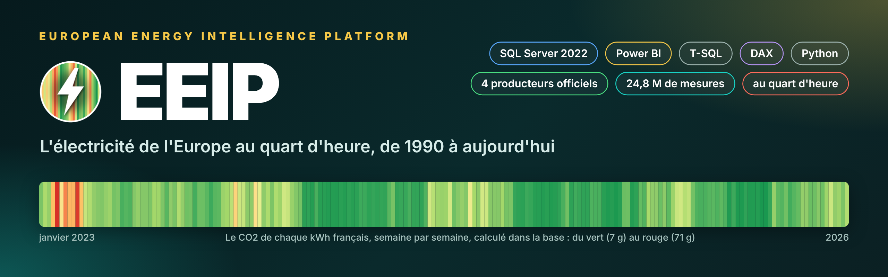</p>

# EEIP · European Energy Intelligence Platform

**L'entrepôt européen de l'électricité sur SQL Server 2022, et son rapport Power BI de huit pages.**
La consommation, la production par filière, les prix de gros, les échanges aux frontières, le mix et le CO2 de chaque kWh, **au quart d'heure près**. Quatre producteurs officiels, **RTE**, **éCO2mix** (Open Data Réseaux Énergies), **ENTSO-E** et **Eurostat**, réunis dans une seule table de séries temporelles : en UTC, historisée version par version, partitionnée par mois, compressée en columnstore ordonné, arbitrée jour par jour par un golden record, contrôlée à chaque lot, servie en heure locale, automatisée et présentée dans Power BI.

[](https://github.com/abdoulhamiddiallo/eeip-sql-server/actions/workflows/tests.yml)


| 📘 Le guide | 📊 Le rapport Power BI | 🧠 Le modèle sémantique | 🧱 Le code |
|---|---|---|---|
| **[GUIDE.md](GUIDE.md)** · 13 étapes, chaque commande à copier · **[PDF de 15 pages](docs/EEIP_Guide_Public.pdf)** | **[docs/EEIP_Rapport_PowerBI.pdf](docs/EEIP_Rapport_PowerBI.pdf)** · 8 pages | **[docs/MODELE_SEMANTIQUE.md](docs/MODELE_SEMANTIQUE.md)** · 23 tables, 261 mesures et leur DAX | **[sql/](sql)** 17 scripts · **[ingestion/](ingestion)** Python · **[powerbi/](powerbi)** PBIP · **[tests/](tests)** |

## 🎬 La démo en mouvement

<p align="center">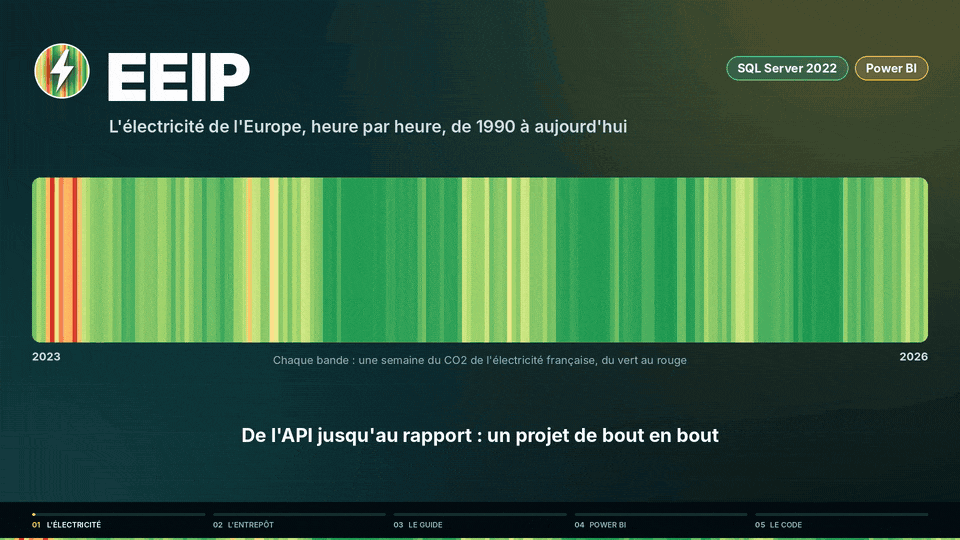</p>

<details>
<summary><b>📑 Sommaire</b></summary>

- [🎬 La démo en mouvement](#-la-démo-en-mouvement)
- [📸 Aperçu du tableau de bord](#-aperçu-du-tableau-de-bord)
- [📊 Résultats clés](#-résultats-clés)
- [⚡ Ce que disent les données](#-ce-que-disent-les-données)
- [💼 Impact métier](#-impact-métier)
- [🧭 Résumé](#-résumé)
- [🔄 Pipeline](#-pipeline)
- [🧬 Lignage](#-lignage)
- [🏗️ Architecture](#️-architecture)
- [🗂️ Organisation des données](#️-organisation-des-données)
- [📈 Le rapport Power BI](#-le-rapport-power-bi)
- [🧠 Modèle sémantique](#-modèle-sémantique)
- [🛡️ Qualité](#️-qualité)
- [🚀 Optimisation](#-optimisation)
- [🤖 Exploitation](#-exploitation)
- [🧰 Stack technique](#-stack-technique)
- [📘 Le guide en 13 étapes](#-le-guide-en-13-étapes)
- [⏱️ Démarrage rapide](#️-démarrage-rapide)
- [🔎 Vérifier dans SSMS](#-vérifier-dans-ssms--la-france-exportatrice)
- [📁 Structure du dépôt](#-structure-du-dépôt)
- [✅ Conclusion](#-conclusion)
- [💡 Dernière pensée](#-dernière-pensée)

</details>

---

## 📸 Aperçu du tableau de bord

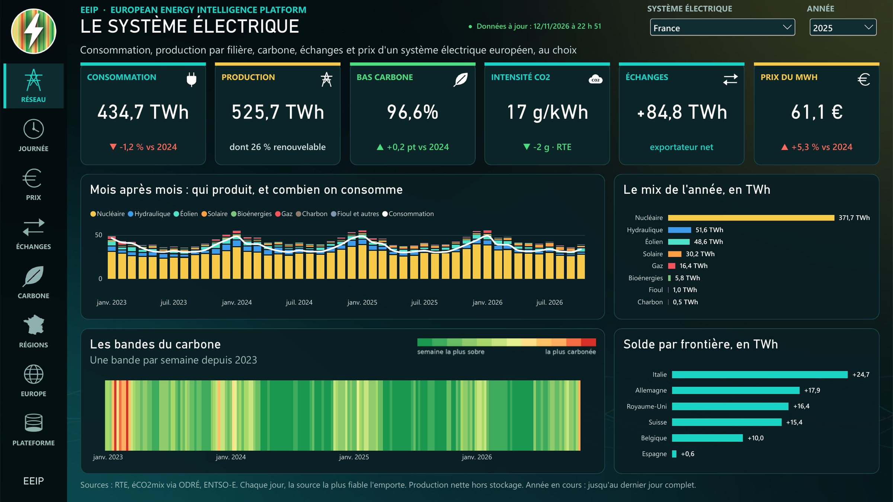

| | |
|---|---|
| 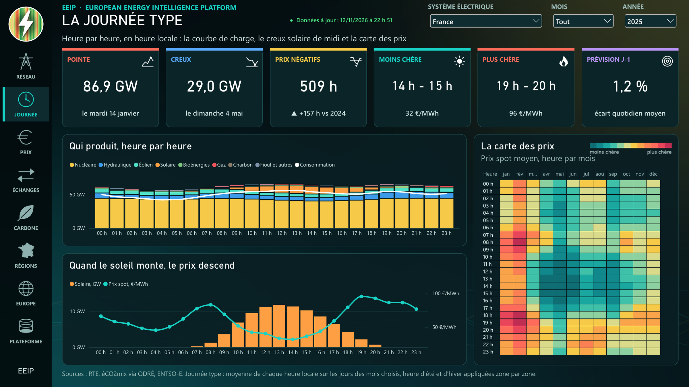 | 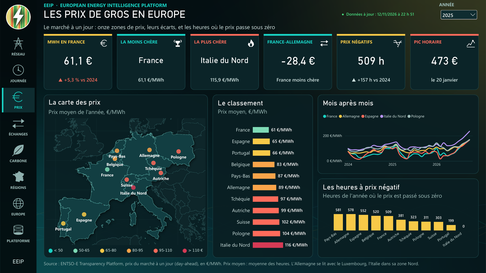 |
| **La journée type** · heure par heure en heure locale : la courbe de charge, le creux solaire de midi et la carte des prix | **Les prix de gros** · onze zones de prix, leurs écarts, et les heures où le prix passe sous zéro |
| 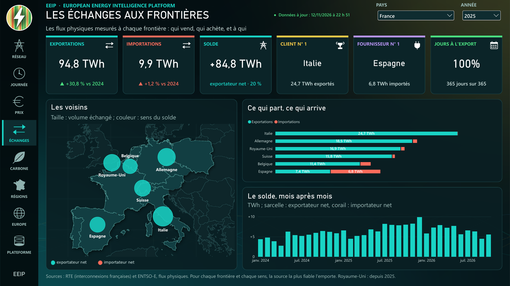 | 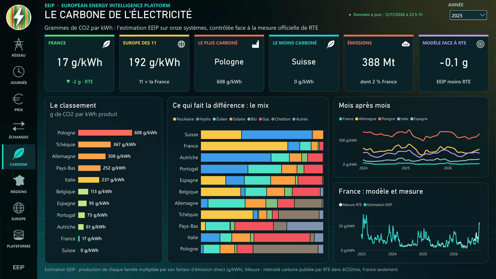 |
| **Les échanges** · les flux physiques à chaque frontière : qui vend, qui achète, et à qui | **Le carbone** · les grammes de CO2 par kWh de onze systèmes, l'estimation contrôlée face à la mesure de RTE |
| 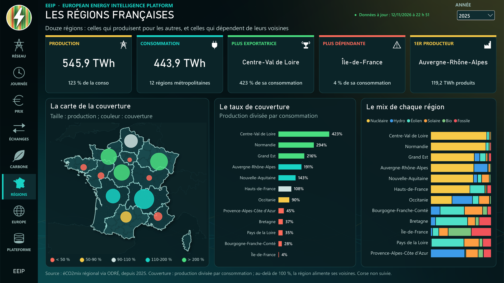 | 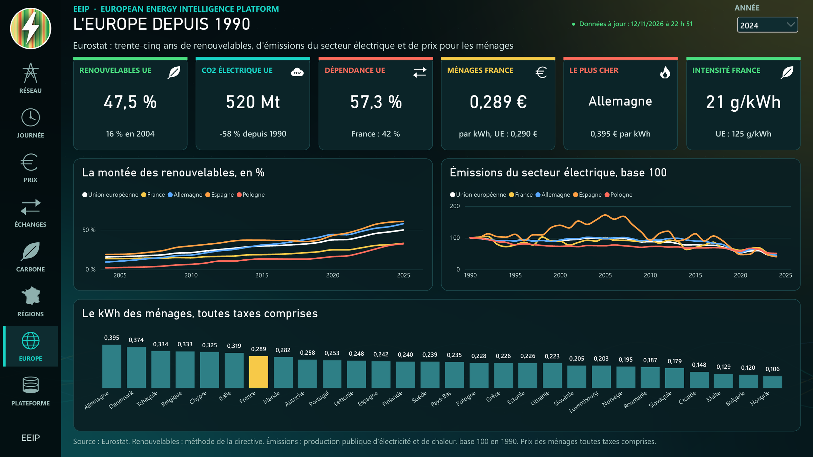 |
| **Les régions françaises** · celles qui produisent pour les autres, et celles qui dépendent de leurs voisines | **L'Europe depuis 1990** · trente-cinq ans de renouvelables, d'émissions et de prix pour les ménages |

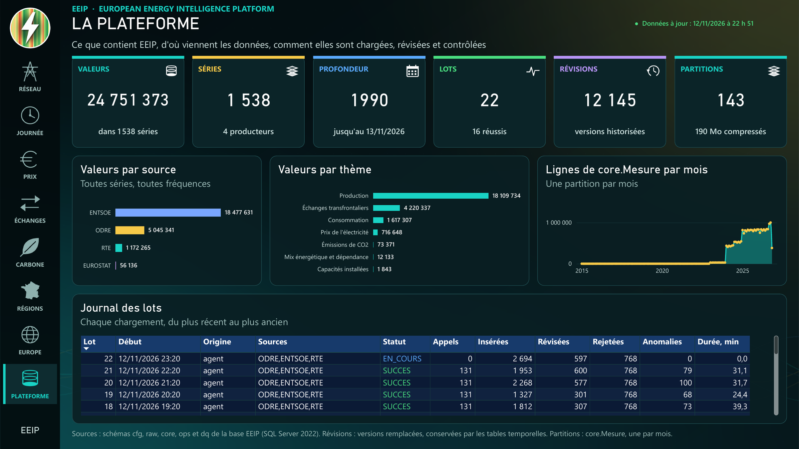

---

## 📊 Résultats clés

| Mesure | Valeur |
|---|---|
| Producteurs officiels | **4** : RTE (OAuth 2), éCO2mix via ODRÉ (JSON), ENTSO-E (XML), Eurostat (JSON-stat) · **4 formats, une seule table** |
| Mesures historisées | **24 751 373**, de 1990 (Eurostat) au quart d'heure de la dernière heure |
| Séries | **1 538** (indicateur × zone × filière × source × pas) |
| Le pas le plus fin | **15 minutes**, sur 11 pays et 13 systèmes éCO2mix |
| Référentiel | **54 zones** (pays, zones de prix, régions), **31 filières** en 13 familles, **21 indicateurs** en 7 thèmes, **19 frontières** |
| Catalogue d'ingestion | **111 requêtes** en JSON validé, chacune avec son filigrane |
| Jours locaux calculés | **360 625** (`mart.MesureJour`) · panel Eurostat de **1 141** lignes pays × année |
| Corrections conservées | **12 145** anciennes versions, lisibles à n'importe quelle date (`FOR SYSTEM_TIME AS OF`) |
| Réponses API reçues puis compressées | **2,4 Go → 175 Mo**, soit **×14**, rejouables par `DECOMPRESS` |
| Partitionnement | **148 partitions mensuelles**, la dernière toujours vide |
| Rejouer un chargement | **0 doublon** : une réponse identique est reconnue par son empreinte SHA-256 |
| Contrôle final automatique | **14 sur 14** · **18 tests** hors ligne du programme d'ingestion |
| Rapport Power BI | **8 pages**, **23 tables**, **20 relations**, **261 mesures DAX** |

---

## ⚡ Ce que disent les données

| Constat | Chiffre | Où le voir |
|---|---|---|
| La France, exportatrice nette | solde de **+84,8 TWh** en 2025 (94,8 exportés, 9,9 importés), exportatrice **365 jours sur 365** | page 4 |
| Son premier client | **l'Italie**, 24,7 TWh achetés à la France en 2025 | page 4 |
| Une électricité presque sans carbone | **96,6 %** de production bas carbone, **17 g de CO2 par kWh** | pages 1 et 5 |
| Le nucléaire | **371,7 TWh** sur 525,7 TWh produits, soit **71 %** | page 1 |
| La pointe de l'année | **86,9 GW** le mardi 14 janvier 2025 | page 2 |
| Le soleil fait tomber le prix | de **96 €/MWh** à 19 h à **32 €/MWh** à 14 h, en moyenne | page 2 |
| Les prix négatifs | **509 heures** sous zéro en France en 2025, **157 de plus** qu'en 2024 | pages 2 et 3 |
| Le MWh le moins cher des onze zones | **la France, 61,1 €**, contre 115,9 € en Italie du Nord | page 3 |
| L'écart avec la Pologne | **608 g/kWh**, plus de **35 fois** l'intensité française | page 5 |
| Une estimation fidèle | le modèle EEIP s'écarte de **0,1 g/kWh** de la mesure publiée par RTE | page 5 |
| La région qui alimente les autres | **Centre-Val de Loire**, 423 % de sa consommation ; l'Île-de-France, 4 % | page 6 |
| L'Europe depuis 1990 | émissions du secteur électrique de l'UE : **-58 %** ; renouvelables : **47,5 %** de l'électricité en 2024 | page 7 |

---

## 💼 Impact métier

- **Une seule table pour quatre producteurs** : un quart d'heure éCO2mix, un prix horaire ENTSO-E et une statistique annuelle Eurostat vivent dans le même modèle, avec la même unité, le même rang de qualité et le même lignage.
- **La meilleure source, jour par jour** : quand RTE, éCO2mix et ENTSO-E publient la même grandeur, le golden record retient la plus fiable et le contrôle `CONCORDANCE` mesure leur écart.
- **Rien ne s'efface** : quand le consolidé remplace le temps réel, puis le définitif le consolidé, chaque version part dans l'historique. La base répond à la question d'un auditeur : « quelle consommation affichions-nous il y a une semaine ? ».
- **Le temps maîtrisé** : tout est stocké en UTC et servi en heure locale de chaque zone ; les jours de 23 et de 25 heures comptent juste.
- **La qualité mesurée, pas supposée** : valeurs hors bornes, sauts, trous, révisions fortes, sources en désaccord, codes inconnus : tout est détecté à chaque lot et visible dans le rapport.
- **Zéro intervention** : trois travaux de l'Agent SQL Server chargent, calculent, entretiennent, sauvegardent et préparent le rapport. Une actualisation suffit à Power BI.
- **Évolutive sans code** : une zone de prix de plus, c'est une ligne dans le catalogue.

---

## 🧭 Résumé

EEIP est un entrepôt de données de niveau production, construit sur un poste Windows avec des outils gratuits. Un programme Python lit les quatre producteurs par fenêtres de temps, conserve chaque réponse brute compressée, puis des procédures stockées T-SQL intègrent les mesures dans **une seule table de séries temporelles**, columnstore ordonné, partitionnée par mois et versionnée par le système.

Une couche analytique transforme ensuite les instants UTC en **jours locaux**, choisit **la meilleure source** jour par jour, calcule le mix, les prix, les échanges et l'**intensité carbone**, et publie un panel pays × année depuis 1990. Une API de lecture sert les séries en JSON, y compris **telles qu'elles étaient à une date passée**. Au bout de la chaîne, un **schéma `bi`** alimente un **modèle sémantique Power BI** au format PBIP : tables, relations et 261 mesures DAX sont des fichiers texte TMDL, versionnés comme le SQL.

Le projet couvre ce qu'un architecte de données Microsoft doit maîtriser : **ingestion d'API (REST, OAuth 2, XML, JSON-stat), séries temporelles, historisation, partitionnement, columnstore, procédures stockées, optimisation des requêtes, qualité, exploitation, modélisation sémantique et restitution Power BI**.

---

## 🔄 Pipeline

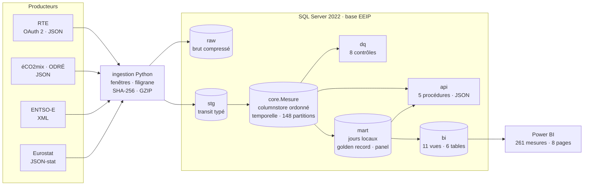

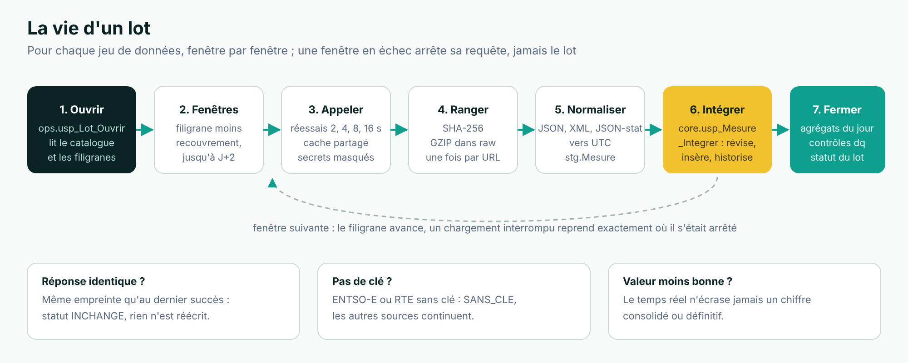

1. **Ouvrir un lot** et lire le catalogue `cfg.RequeteACharger` : quoi charger, depuis quel filigrane.
2. **Calculer les fenêtres** du filigrane moins le recouvrement jusqu'à après-demain (les prix du lendemain sont publiés la veille) ; ENTSO-E jamais plus d'un an par appel.
3. **Extraire** : une méthode par producteur, réessais automatiques, jeton OAuth 2 de RTE renouvelé seul, un seul appel par fenêtre pour toutes les requêtes d'un même jeu.
4. **Comparer l'empreinte SHA-256** : rien n'a changé, rien n'est réécrit.
5. **Ranger la réponse brute** compressée (GZIP) dans `raw.Payload`, le jeton remplacé par `***`.
6. **Analyser** chaque format en lignes uniformes, en UTC : les courbes `A03` d'ENTSO-E prolongées, le pompage compté en négatif, le JSON-stat décodé ligne par ligne.
7. **Insérer en masse** dans le transit typé `stg.Mesure` (`fast_executemany`).
8. **Intégrer** dans `core.Mesure` avec `core.usp_Mesure_Integrer` : chaque code résolu une seule fois, une révision seulement si la valeur change et si la qualité est au moins aussi bonne.
9. **Contrôler la qualité**, avancer le filigrane, fermer le lot, recalculer les jours touchés, puis **rafraîchir le schéma `bi`** : Power BI est à jour.

---

## 🧬 Lignage

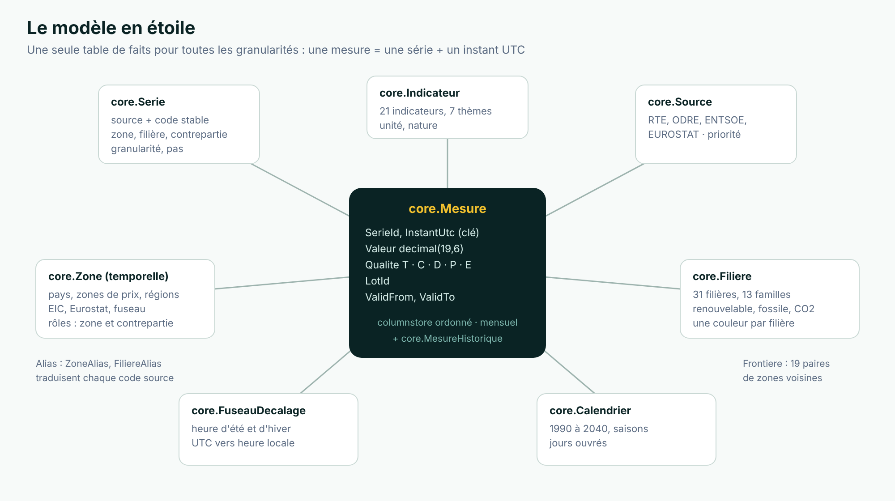

Chaque mesure garde son lignage complet : **producteur → code exact de la source → alias de filière et de zone → série → lot de chargement → réponse brute**. `B14` chez ENTSO-E, `N9000` chez Eurostat, `NUCLEAR` chez RTE et `nucleaire` chez éCO2mix deviennent la même filière **NUCLEAIRE** ; le code EIC `10YCB-GERMANY--8` comme `DE` désignent l'Allemagne. Le rang de qualité commun, **T** (temps réel), **C** (consolidé), **D** (définitif), décide quelle valeur peut en remplacer une autre.

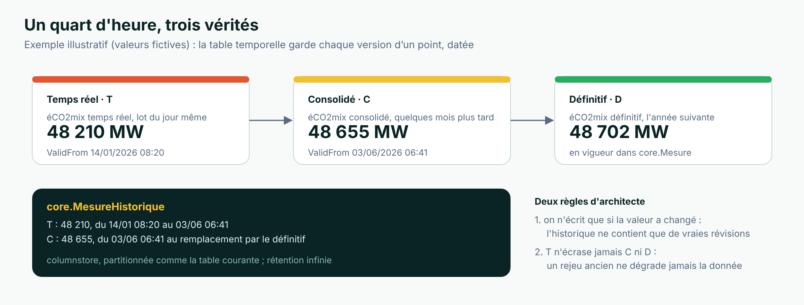

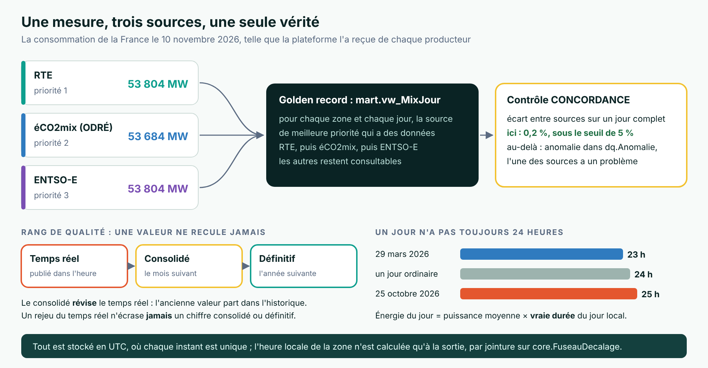

---

## 🏗️ Architecture

<p align="center">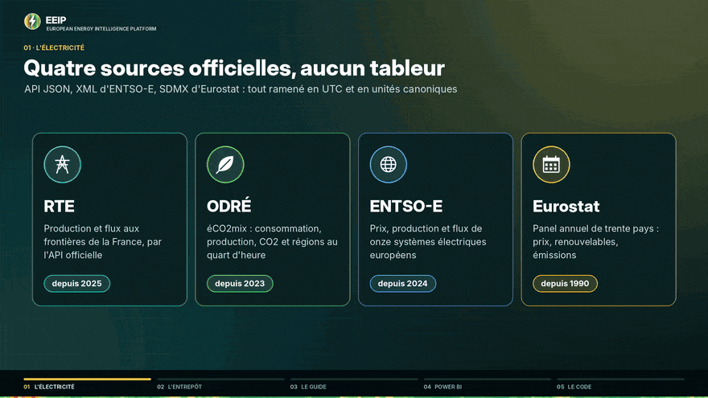</p>

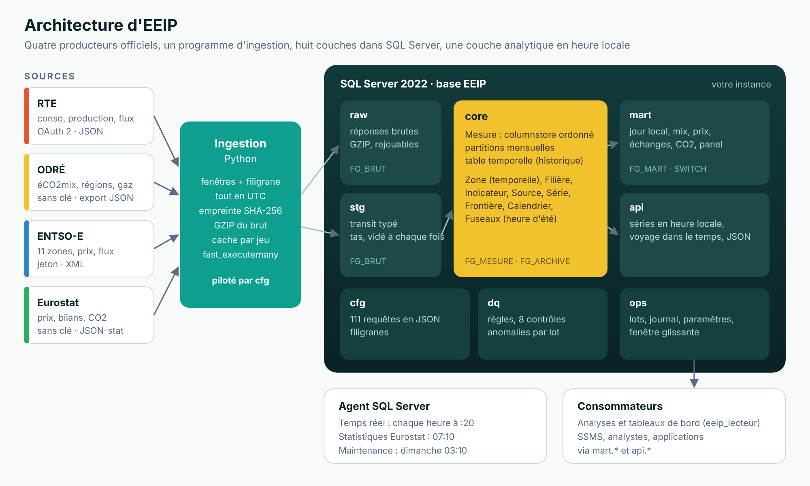

| Schéma | Rôle | Groupe de fichiers |
|---|---|---|
| `cfg` | catalogue des 111 requêtes, paramètres en JSON validé, filigranes | FG_REFERENTIEL |
| `raw` | réponses API brutes compressées, rejouables | FG_BRUT |
| `stg` | transit typé, vidé après chaque intégration | FG_BRUT |
| `core` | référentiel, fuseaux, séries, mesures temporelles | FG_REFERENTIEL · FG_MESURE · FG_ARCHIVE |
| `dq` | règles et anomalies de qualité | FG_REFERENTIEL |
| `mart` | jours locaux, mix, prix, échanges, CO2, panel pays × année | FG_MART |
| `api` | 5 procédures de lecture, tableau ou JSON | |
| `ops` | lots, journal, paramètres, maintenance | FG_REFERENTIEL |
| `bi` | 11 vues et 6 tables en français, réservées à Power BI | |

### Un mois par partition, la dernière toujours vide

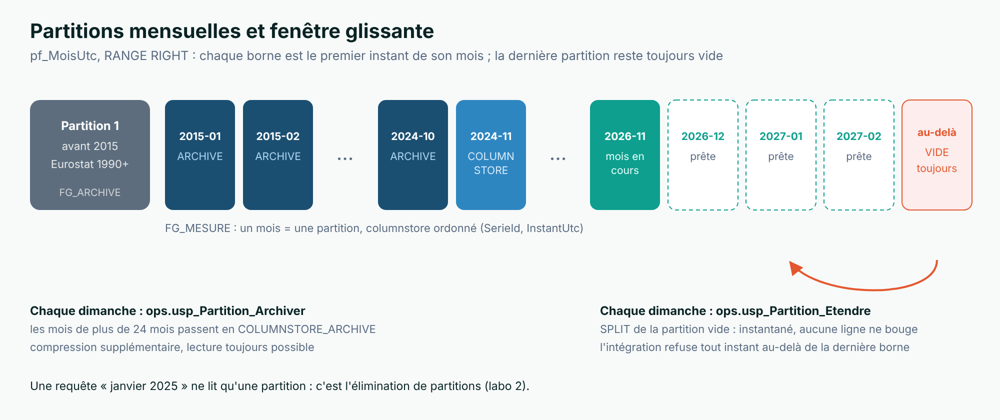

Au quart d'heure, une seule série produit 35 000 points par an : `core.Mesure` est découpée **par mois** depuis 2015 sur `FG_MESURE`, tout ce qui précède (Eurostat depuis 1990) dormant sur `FG_ARCHIVE`. Les bornes sont générées par `GENERATE_SERIES`. La dernière partition reste **toujours vide** : avec un columnstore, SQL Server ne coupe qu'une partition vide, et la maintenance crée chaque mois la suivante sans déplacer une ligne. La couche analytique a sa propre fonction, `pf_MoisDate`, en jours locaux.

### Le temps, de l'UTC à l'heure locale

Tout est stocké en **UTC**. `core.FuseauDecalage` pré-calcule les périodes d'heure d'été et d'hiver de chaque fuseau : **une jointure par intervalle** remplace des millions d'`AT TIME ZONE`. Les heures demandées à l'API sont converties une seule fois en UTC, puis seules les partitions utiles sont lues.

---

## 🗂️ Organisation des données

| Table | Grain | Lignes | Ce qu'il faut savoir |
|---|---|---:|---|
| `core.Source` | un producteur | 4 | RTE, ODRÉ, ENTSO-E, Eurostat, avec leur priorité dans le golden record |
| `core.Theme` · `core.Indicateur` | un indicateur canonique | 7 · 21 | consommation, production, prix, échanges, CO2, capacités, mix et dépendance |
| `core.Zone` | un pays, une zone de prix, une région | 54 | **temporelle** ; code EIC, fuseau, pays parent, position |
| `core.ZoneAlias` | un code de producteur | 25 | les codes EIC et les noms de pays ramenés à une zone |
| `core.Filiere` · `core.FiliereAlias` | une filière, un code source | 31 · 65 | 13 familles, facteur d'émission en g de CO2 par kWh |
| `core.Frontiere` | une frontière électrique | 19 | chargée dans les deux sens |
| `core.Serie` | indicateur × zone × filière × source × pas | 1 538 | du quart d'heure à l'année ; filigrane et nombre de points |
| `core.Mesure` | série × instant UTC | 24 751 373 | **columnstore cluster ordonné** `(SerieId, InstantUtc)`, clé primaire non cluster alignée, **versionnée par le système** |
| `core.MesureHistorique` | une ancienne version | 12 145 | columnstore et partitionnée comme la table courante, rétention infinie |
| `core.Calendrier` | un jour | 18 628 | de 1990 à 2040 |
| `core.FuseauDecalage` | fuseau × période | 441 | heures d'été et d'hiver pré-calculées |
| `cfg.RequeteACharger` | une requête | 111 | paramètres en JSON validé par `ISJSON(..., OBJECT)` |
| `raw.Payload` | une réponse API | 2 637 | GZIP, empreinte SHA-256, statut HTTP, URL sans secret |
| `mart.MesureJour` | série × jour local | 360 625 | moyenne, pointe, creux, énergie, minutes de prix négatifs, complétude ; partitionnée par mois |
| `mart.PanelPaysAnnee` | pays × année | 1 141 | 20 indicateurs Eurostat, reconstruit à part puis basculé par `SWITCH` |
| `dq.Regle` · `dq.Anomalie` | un seuil, un signalement | 9 · 5 204 | seuils modifiables sans toucher au code |
| `ops.Lot` · `ops.Journal` | un chargement, un message | 22 · 3 113 | appels, lignes insérées, révisées, inchangées, durée, statut |

### Les volumes par producteur

| Producteur | Séries | Valeurs | Depuis | Pas | Réponses brutes |
|---|---:|---:|---|---|---|
| **ENTSO-E** · 11 pays : consommation, production par filière, prix, flux, capacités | 527 | 18 477 631 | 2015 (capacités), 2024 au quart d'heure | 15 min | 2 107 · 1,6 Go → 95 Mo |
| **éCO2mix · ODRÉ** · national, 12 régions, échanges, CO2, prévision, gaz | 115 | 5 045 341 | 2023 | 15 min | 186 · 658 Mo → 62 Mo |
| **RTE** · consommation, production, flux aux 8 interconnexions | 27 | 1 172 265 | 2025 | 15 min et 1 h | 323 · 186 Mo → 9 Mo |
| **Eurostat** · 30 pays : prix, bilans, mix primaire, émissions | 869 | 56 136 | 1990 | mois, semestre, année | 21 · 25 Mo → 8 Mo |
| **Total** | **1 538** | **24 751 373** | | | **2 637 · 2,4 Go → 175 Mo** |

---

## 📈 Le rapport Power BI

<p align="center">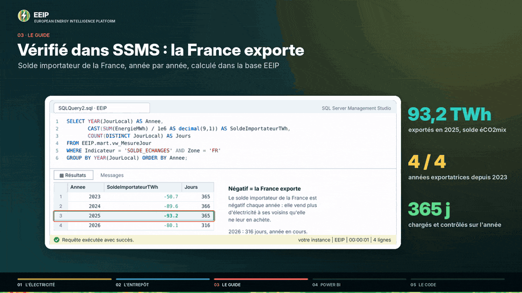</p>

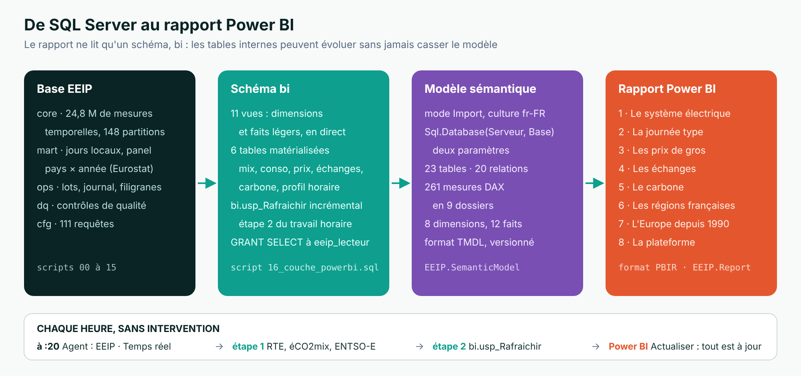

Le rapport ne lit **qu'un schéma**, `bi`. Les dimensions et les faits légers sont des vues lues en direct ; les faits lourds sont **matérialisés** par `bi.usp_Rafraichir`, **de façon incrémentale** : seuls les jours recalculés depuis le passage précédent sont repris (filigrane `BI_DERNIER_CALCUL`), si bien qu'une révision consolidée sur un jour ancien est bien propagée. C'est l'étape 2 du travail horaire de l'Agent.

| Page | Ce qu'elle montre | Indicateurs clés |
|---|---|---|
| **1 · Le système électrique** | le mix mois après mois face à la consommation, le mix de l'année, les bandes du carbone, le solde par frontière | consommation, production, bas carbone, intensité CO2, échanges, prix du MWh |
| **2 · La journée type** | qui produit heure par heure, le creux solaire qui fait baisser le prix, la carte des prix heure × mois | pointe, creux, heures de prix négatifs, heure la moins chère et la plus chère, précision de la prévision J-1 |
| **3 · Les prix de gros** | la carte et le classement des onze zones, les prix mois après mois, les heures à prix négatif | MWh en France, zone la moins chère et la plus chère, écart France-Allemagne, pic horaire |
| **4 · Les échanges** | les voisins sur la carte, ce qui part et ce qui arrive, le solde mois après mois | exportations, importations, solde, client et fournisseur n° 1, jours à l'export |
| **5 · Le carbone** | le classement de onze systèmes, le mix qui fait la différence, l'estimation EEIP face à la mesure de RTE | intensité France et Europe, le plus et le moins carboné, émissions, écart modèle et mesure |
| **6 · Les régions françaises** | la carte de la couverture, le taux de couverture, le mix de chaque région | production, consommation, région la plus exportatrice, la plus dépendante, premier producteur |
| **7 · L'Europe depuis 1990** | la montée des renouvelables, les émissions du secteur électrique en base 100, le kWh des ménages dans chaque pays | renouvelables UE, CO2 électrique UE, dépendance, prix des ménages, intensité France |
| **8 · La plateforme** | la base mesurée par elle-même : valeurs par source et par thème, lignes par mois, journal des lots | valeurs, séries, profondeur, lots, révisions, partitions |

Une navigation latérale à icônes relie les huit pages ; chaque carte indique sa comparaison avec l'année précédente, et le bandeau affiche l'heure du dernier chargement.

---

## 🧠 Modèle sémantique

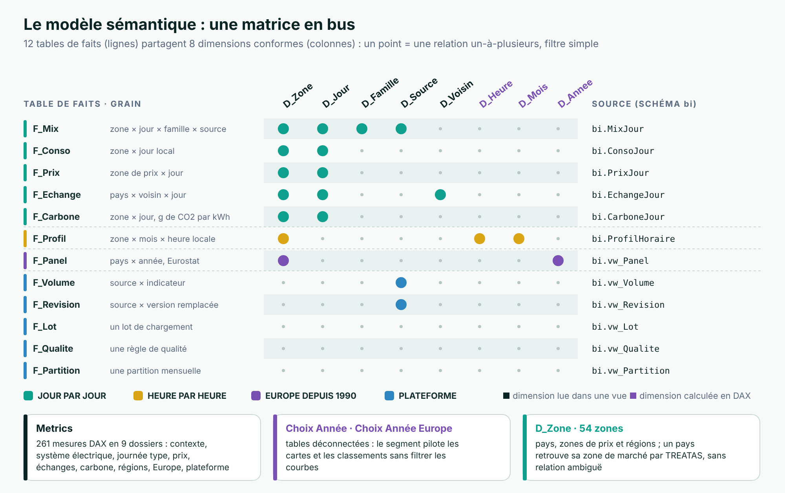

| Élément | Contenu |
|---|---|
| Dimensions | `D_Zone` (54 zones, nom court, type, zone de prix), `D_Jour` (calendrier local), `D_Famille` (couleur fixe, bas carbone, renouvelable, facteur d'émission), `D_Source`, `D_Voisin` lues dans des vues ; `D_Heure`, `D_Mois`, `D_Annee` calculées en DAX |
| Faits jour par jour | `F_Mix` (golden record), `F_Conso`, `F_Prix`, `F_Echange`, `F_Carbone` |
| Fait heure par heure | `F_Profil` : la journée type de chaque mois, en heure locale |
| Fait européen | `F_Panel` : Eurostat, un pays et une année, depuis 1990 |
| Faits de la plateforme | `F_Volume`, `F_Revision`, `F_Lot`, `F_Qualite`, `F_Partition` |
| Tables déconnectées | `Choix Année` et `Choix Année Europe` : le segment pilote les cartes et les classements sans filtrer les courbes |
| Mesures | **261**, dans la table `Metrics`, en 9 dossiers : contexte (54), système électrique (32), journée type (21), prix (26), échanges (23), carbone (36), régions (18), Europe (37), plateforme (14) |
| Connexion | mode Import, `Sql.Database(Serveur, Base)`, deux paramètres, culture fr-FR |

Les techniques DAX à retenir :

- **L'année en cours comparée à la même période** : jusqu'au dernier jour complet, face aux mêmes jours de l'année précédente, jamais une année partielle face à une année entière.
- **Un pays retrouve sa zone de marché** par `TREATAS` : la France et ses prix, l'Allemagne et la zone DE-LU, sans relation ambiguë dans le modèle.
- **Les périodes incomplètes masquées** : une courbe s'arrête au dernier jour complet au lieu de plonger.
- **Les classements dans la mesure** : zone la moins chère, client n° 1, région la plus dépendante, sans filtre de visuel.
- **Les couleurs calculées** : flèches ▲▼, sens du solde, échelles relatives des cartes de chaleur, appliqués par mise en forme conditionnelle.

Toutes les tables, colonnes, relations et les 261 mesures avec leur code DAX : **[docs/MODELE_SEMANTIQUE.md](docs/MODELE_SEMANTIQUE.md)**.

---

## 🛡️ Qualité

Huit contrôles, lancés à la fin de chaque lot ; leurs neuf seuils (5 % d'écart entre sources, 20 % de révision, 48 heures de silence...) vivent dans `dq.Regle` et se règlent sans toucher au code.

| Contrôle | Ce qu'il détecte |
|---|---|
| `FRAICHEUR` | une requête qui n'apporte plus de données récentes |
| `HORS_BORNES` | un prix aberrant, une puissance démesurée, une production négative |
| `SAUT` | une consommation qui varie brutalement d'un point à l'autre |
| `TROU` | des quarts d'heure manquants, trouvés par `LAG` |
| `REVISION_FORTE` | une valeur révisée de plus de 20 %, lue dans l'historique |
| `CONCORDANCE` | RTE, éCO2mix et ENTSO-E en désaccord sur un même jour |
| `ZONE_DEDUITE` | une zone sans correspondance, à rattacher |
| `CODE_INCONNU` | une filière de la source sans alias |

Le programme d'ingestion est couvert par **18 tests hors ligne** (`tests/test_ingestion.py`), lancés par GitHub Actions à chaque envoi : conversion en UTC, fenêtres et filigranes, courbes `A03` d'ENTSO-E, pompage en négatif, révision du temps réel par le consolidé, décodage JSON-stat, jeton masqué.

---

## 🚀 Optimisation

Le script `12_laboratoire_optimisation.sql` propose **12 expériences** à lancer bloc par bloc avec le plan d'exécution réel : élimination de partitions, fonction sur une colonne contre bornes converties une fois, **segments columnstore sautés** grâce au tri, mode batch contre mode ligne, magasin delta et groupes de lignes compressés, recherche par la clé non cluster, `PERCENTILE_CONT` exact contre `APPROX_PERCENTILE_CONT`, **un plan par profil de paramètre** (la France contre la Bretagne, SQL Server 2022), Query Store et indication posée sans redéployer, compression `COLUMNSTORE_ARCHIVE` et voyage dans le temps.

Le script `15_requetes_analyse.sql` répond à **12 questions d'énergéticien** en une requête chacune : la courbe en canard du solaire, le jour de pointe de chaque année, les heures de prix négatifs, l'écart de prix France-Allemagne et sa **corrélation avec l'éolien allemand** (Pearson en pur SQL), le classement carbone des zones, le solde par voisin, le facteur de charge du nucléaire, et trois sources pour une même consommation.

---

## 🤖 Exploitation

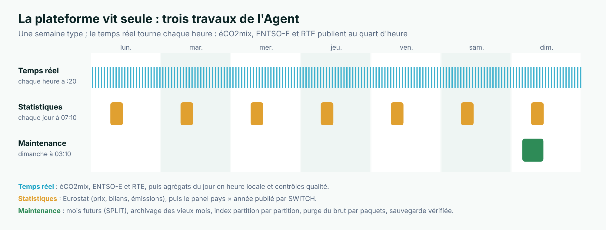

| Travail de l'Agent | Quand | Ce qu'il fait |
|---|---|---|
| **EEIP · Temps réel** | chaque heure à :20 | éCO2mix, ENTSO-E et RTE, jours locaux, contrôles qualité ; **étape 2 : couche Power BI** |
| **EEIP · Statistiques** | chaque jour à 07:10 | Eurostat (prix, bilans, émissions), puis le panel pays × année publié par `SWITCH` |
| **EEIP · Maintenance** | le dimanche à 03:10 | partitions des mois futurs (`SPLIT`), archivage, index et statistiques partition par partition, purge du brut par paquets de 2 000, sauvegarde compressée et vérifiée |

---

## 🧰 Stack technique

| Couche | Technologies |
|---|---|
| Moteur | SQL Server 2022 Developer, niveau de compatibilité 160 |
| Stockage | 6 groupes de fichiers, partitionnement mensuel `RANGE RIGHT`, columnstore cluster **ordonné**, `COLUMNSTORE_ARCHIVE` |
| Historisation | tables temporelles versionnées par le système, historique en columnstore partitionné, rang de qualité |
| Temps | tout en UTC, heure locale par jointure sur `core.FuseauDecalage`, `DATE_BUCKET` |
| Analytique | golden record, clause `WINDOW`, `APPROX_PERCENTILE_CONT`, `GENERATE_SERIES`, `STRING_SPLIT` ordinal, `ALTER TABLE ... SWITCH` |
| JSON | `ISJSON(..., OBJECT)`, `JSON_MODIFY`, `FOR JSON`, catalogue piloté par JSON |
| Fiabilité | `READ_COMMITTED_SNAPSHOT`, Accelerated Database Recovery, `XACT_ABORT`, `TRY/CATCH` |
| Performance | Query Store, optimisation des plans sensibles aux paramètres (PSP), DOP feedback, plans d'exécution |
| Ingestion | Python, `requests` et réessais, `pyodbc` (`fast_executemany`), ODBC Driver 18, OAuth 2, XML, JSON-stat, GZIP, SHA-256 |
| Tests | 18 tests hors ligne, GitHub Actions |
| Exploitation | Agent SQL Server, maintenance par partition, sauvegarde compressée vérifiée, contrôle final automatique |
| Restitution | Power BI Desktop, projet PBIP, modèle TMDL, rapport PBIR, DAX, mise en forme conditionnelle |
| Sources | RTE (data.rte-france.com), éCO2mix via Open Data Réseaux Énergies, ENTSO-E Transparency Platform, Eurostat |

---

## 📘 Le guide en 13 étapes

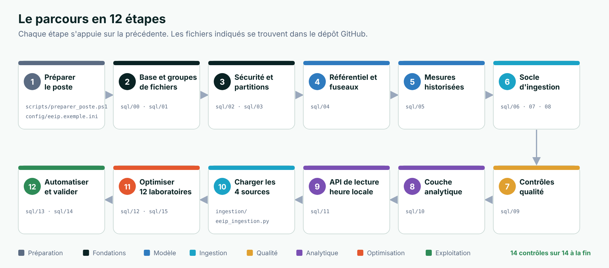

| | Étape | Fichiers | Ce que vous obtenez |
|---:|---|---|---|
| 1 | Préparer le poste et obtenir les deux clés | `scripts/preparer_poste.ps1` · `config/` | Python pour tous les utilisateurs, ODBC 18, l'Agent prêt ; jeton ENTSO-E et application RTE |
| 2 | La base et ses groupes de fichiers | `sql/00` · `sql/01` | la base EEIP, 6 groupes de fichiers, options SQL Server 2022 |
| 3 | Sécurité et partitionnement mensuel | `sql/02` · `sql/03` | 8 schémas, 2 rôles, environ 147 partitions mensuelles |
| 4 | Le référentiel et les fuseaux horaires | `sql/04` | 13 tables, zones temporelles, calendrier de 18 628 jours |
| 5 | La table des mesures | `sql/05` | `core.Mesure` : columnstore ordonné, temporelle, partitionnée |
| 6 | Le socle d'ingestion | `sql/06` · `07` · `08` | lots, brut, transit, vocabulaire, 111 requêtes, 8 procédures |
| 7 | Les contrôles qualité | `sql/09` | les règles et la procédure de contrôle |
| 8 | La couche analytique | `sql/10` | jours locaux, golden record, 5 vues, panel pays × année |
| 9 | L'API de lecture | `sql/11` | 5 procédures, JSON, voyage dans le temps |
| 10 | Charger les quatre sources | `ingestion/eeip_ingestion.py` | 24,8 millions de mesures, le mix et le solde de la France |
| 11 | Le laboratoire d'optimisation | `sql/12` · `sql/15` | 12 expériences, 12 analyses |
| 12 | Automatiser et valider | `sql/13` · `sql/14` | 3 travaux de l'Agent, **14 contrôles OK sur 14** |
| 13 | La couche Power BI et le rapport | `sql/16` · `powerbi/` | le schéma `bi`, le rapport de 8 pages actualisé chaque heure |

Chaque étape, son pourquoi, ses commandes et son résultat attendu : **[GUIDE.md](GUIDE.md)**, ou le **[guide PDF](docs/EEIP_Guide_Public.pdf)** pour un second écran.

---

## ⏱️ Démarrage rapide

1. Installez **SQL Server 2022 Developer**, **SSMS**, **Python 3.12 ou plus** (pour tous les utilisateurs), puis **Power BI Desktop**.
2. Placez ce dépôt dans `C:\EEIP` :
   ```powershell
   git clone https://github.com/abdoulhamiddiallo/eeip-sql-server C:\EEIP
   ```
3. Dans un Terminal **administrateur** :
   ```powershell
   powershell -ExecutionPolicy Bypass -File C:\EEIP\scripts\preparer_poste.ps1 -Instance MSSQLSERVER
   ```
4. Demandez un jeton sur `transparency.entsoe.eu` et créez une application sur `data.rte-france.com`, puis copiez `config\eeip.exemple.ini` en `config\eeip.ini` avec le Bloc-notes et renseignez votre instance et les clés. Sans clé, éCO2mix et Eurostat se chargent déjà.
5. Dans SSMS, exécutez les scripts `sql/00` à `sql/11` dans l'ordre (F5).
6. Chargez les données :
   ```powershell
   cd C:\EEIP
   .\.venv\Scripts\python.exe ingestion\eeip_ingestion.py --sources EUROSTAT
   .\.venv\Scripts\python.exe ingestion\eeip_ingestion.py
   ```
7. Les jours locaux se calculent à la fin de chaque lot ; publiez le panel Eurostat :
   ```sql
   EXEC EEIP.mart.usp_Panel_Rafraichir;
   ```
8. Exécutez `sql/13`, puis `sql/14_controle_final.sql` : **14 OK sur 14**.
9. Exécutez `sql/16_couche_powerbi.sql` : le schéma `bi` est prêt et devient l'étape 2 du travail horaire.
10. Ouvrez `powerbi\EEIP.pbip`. Si votre instance ne s'appelle pas `localhost\MSSQLSERVER2022`, changez le paramètre `Serveur` (**Transformer les données**, **Modifier les paramètres**). Cliquez sur **Actualiser**, choisissez **Windows**, puis **Ctrl+S**.

Pour vérifier le programme d'ingestion sans base ni réseau :

```powershell
.\.venv\Scripts\python.exe tests\test_ingestion.py
```

---

## 🔎 Vérifier dans SSMS : la France exportatrice

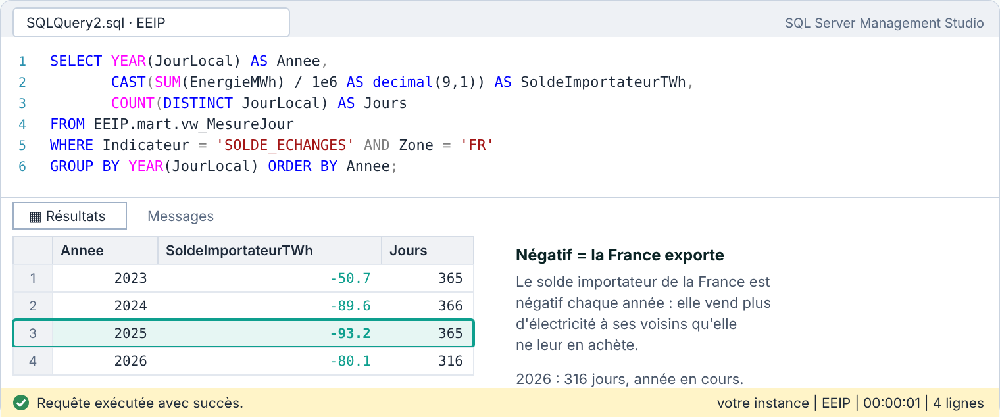

```sql
SELECT YEAR(JourLocal) AS Annee,
       CAST(SUM(EnergieMWh) / 1e6 AS decimal(9,1)) AS SoldeImportateurTWh,
       COUNT(DISTINCT JourLocal) AS Jours
FROM EEIP.mart.vw_MesureJour
WHERE Indicateur = 'SOLDE_ECHANGES' AND Zone = 'FR'
GROUP BY YEAR(JourLocal) ORDER BY Annee;
```

Chaque année est négative : la France vend plus d'électricité à ses voisins qu'elle ne leur en achète. Ce solde est celui que publie éCO2mix pour l'ensemble des interconnexions ; le rapport Power BI additionne, lui, les flux physiques frontière par frontière (page 4). Les deux mesures racontent la même réalité.

Et le voyage dans le temps, en une procédure : la consommation de la France telle que la base l'affichait il y a sept jours.

```sql
DECLARE @vu datetime2(3) = DATEADD(DAY, -7, SYSUTCDATETIME());
EXEC api.usp_Serie_Obtenir @Indicateur = 'CONSO_ELEC', @Zone = 'FR', @Pas = 'P1D', @VuAuUtc = @vu;
```

---

## 📁 Structure du dépôt

```
eeip-sql-server/
├── sql/
│   ├── 00_verification_instance.sql      vérifier l'instance (lecture seule)
│   ├── 01_base.sql                       base, 6 groupes de fichiers, options SQL Server 2022
│   ├── 02_schemas_securite.sql           8 schémas, 2 rôles, compte de l'Agent
│   ├── 03_partitionnement.sql            fonctions et schémas de partition mensuels
│   ├── 04_referentiel.sql                sources, indicateurs, zones temporelles, filières, calendrier, fuseaux
│   ├── 05_mesure_temporelle.sql          la table des mesures : columnstore ordonné, temporelle, partitionnée
│   ├── 06_exploitation_brut_transit.sql  lots, journal, brut compressé, transit
│   ├── 07_donnees_reference.sql          vocabulaire, alias et catalogue des 111 requêtes
│   ├── 08_procedures_ingestion.sql       8 procédures d'intégration
│   ├── 09_qualite.sql                    les contrôles qualité
│   ├── 10_mart_analytique.sql            jours locaux, golden record, 5 vues, panel
│   ├── 11_api_lecture.sql                5 procédures de lecture, JSON et voyage dans le temps
│   ├── 12_laboratoire_optimisation.sql   12 expériences
│   ├── 13_exploitation_agent.sql         maintenance, sauvegarde, 3 travaux planifiés
│   ├── 14_controle_final.sql             la liste de contrôle automatique, 14 points
│   ├── 15_requetes_analyse.sql           12 analyses d'énergéticien
│   └── 16_couche_powerbi.sql             schéma bi : 11 vues, 6 tables, rafraîchissement incrémental
├── ingestion/
│   ├── eeip_ingestion.py                 programme d'ingestion des 4 sources
│   └── requirements.txt
├── tests/test_ingestion.py               18 tests hors ligne, lancés par GitHub Actions
├── powerbi/
│   ├── EEIP.pbip                         le projet à ouvrir dans Power BI Desktop
│   ├── EEIP.SemanticModel/               modèle sémantique : 23 tables TMDL, 261 mesures
│   └── EEIP.Report/                      rapport : 8 pages au format PBIR, thème, icônes, cartes
├── config/eeip.exemple.ini               modèle de configuration
├── scripts/preparer_poste.ps1            préparation automatique du poste
├── GUIDE.md                              le guide de construction en 13 étapes
└── docs/
    ├── EEIP_Guide_Public.pdf             le guide de construction, 15 pages
    ├── EEIP_Rapport_PowerBI.pdf          le rapport Power BI, 8 pages
    ├── MODELE_SEMANTIQUE.md              tables, relations, 261 mesures et leur DAX
    ├── captures/                         les 8 pages du rapport en image
    ├── diagrammes/                       12 diagrammes (SVG et PNG)
    ├── gifs/                             la démo en mouvement : ouverture, entrepôt, rapport
    └── images/                           bannière, aperçu pour les réseaux sociaux
```

---

## ✅ Conclusion

EEIP montre qu'une plateforme européenne de l'électricité complète ne demande ni cloud ni licence : SQL Server 2022 Developer apporte le partitionnement, le columnstore ordonné, les tables temporelles, le JSON et le Query Store, et Power BI Desktop la restitution. La valeur vient de l'architecture : un catalogue qui pilote l'ingestion, un brut rejouable, un vocabulaire commun à quatre producteurs qui parlent quatre langues, une historisation qui n'oublie aucune révision, un golden record qui choisit la meilleure source chaque jour, un temps maîtrisé de l'UTC à l'heure locale, une qualité mesurée à chaque lot, une exploitation automatisée, et une couche de restitution séparée qui protège le rapport des évolutions internes.

---

## 💡 Dernière pensée

> L'électricité ne se stocke presque pas : elle se produit, se vend et se consomme dans le même quart d'heure. Un bon entrepôt garde chacun de ces quarts d'heure, chaque révision et chaque frontière, pour qu'un seul regard suffise à voir qui éclaire l'Europe, à quel prix, et avec combien de carbone.

---

## 👤 Auteur

**Abdoul Hamid Diallo** · Microsoft Fabric Data Engineer
[LinkedIn](https://www.linkedin.com/in/abdoul-hamid-diallo-fabric-data-engineer/) · [GitHub](https://github.com/abdoulhamiddiallo)

**Microsoft Fabric · Power BI · SQL Server · Azure · IA**

**Certifications Microsoft** : DP-600 Fabric Analytics Engineer · DP-700 Fabric Data Engineer · PL-300 Power BI Data Analyst · AI-102 Azure AI Engineer · DP-100 Azure Data Scientist · AI-900 Azure AI Fundamentals · DP-900 Azure Data Fundamentals

---

## 📄 Sources des données

| Producteur | Données | Conditions |
|---|---|---|
| **RTE** (data.rte-france.com) | consommation, production par filière, flux physiques aux interconnexions | conditions du portail RTE |
| **Open Data Réseaux Énergies** (éCO2mix de RTE, GRTgaz, Teréga) | éCO2mix national et régional, temps réel, consolidé et définitif, échanges, CO2, gaz | Licence ouverte Etalab 2.0 |
| **ENTSO-E Transparency Platform** | consommation, production, prix du marché à un jour, flux physiques, capacités installées | conditions ENTSO-E, réutilisation avec citation |
| **Eurostat** | prix de l'électricité, bilans, mix primaire, émissions, dépendance énergétique | CC BY 4.0 |

Les données restent la propriété de leurs producteurs et sont réutilisées selon leurs conditions respectives. Ce dépôt contient le code qui les télécharge, les transforme et les présente, pas les données elles-mêmes.
